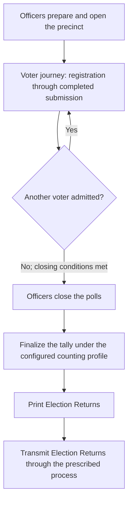
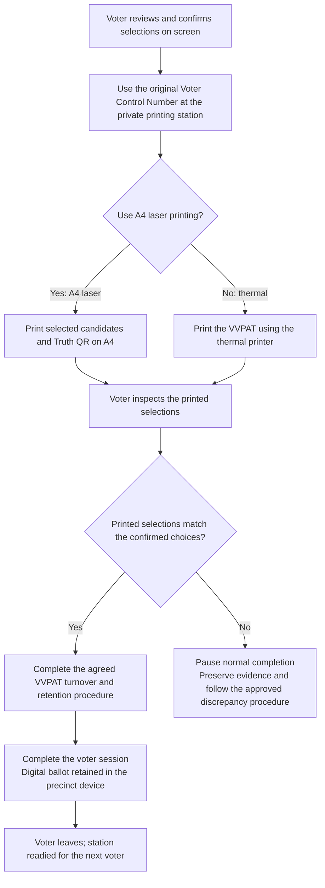

# Voter Journey: OMR and Proposed OpScan with DRE

## Shared election-day context

## Side-by-side voter journey

| Stage | OMR: paper ballot | Proposed OpScan with DRE: PDF ballot |
|---|---|---|
| **1. Arrive and register** | Officer checks identity and registration. | Officer checks identity and registration. |
| **2. Receive ballot access** | Receive a **paper ballot**. | Receive a **Voter Control Number**. The same number is the Print PIN. |
| **3. Enter the private booth** | Place the ballot on the writing surface. | Enter the control number on the fixed tablet. The PDF ballot opens. |
| **4. Choose candidates** | **Shade circles on paper.** | **Tap circles on the PDF ballot.** Change selections before confirmation. |
| **5. Review and finalize** | Review the marked ballot and take it to the scanner. | Review selections and confirm. Leave the tablet in the booth. **No new PIN to copy.** |
| **6. Verify the record** | Feed the ballot into the scanner. Complete the prescribed verification step. | Use the original control number at the printing station. **Print the VVPAT using either A4 laser or thermal printing**, then inspect the printed selections. The A4 format includes Truth QR. |
| **7. Complete custody and leave** | Ballot retained in the ballot box. Verification material follows the prescribed custody process. | **Digital ballot retained in the precinct device.** The printed VVPAT follows the agreed custody procedure. |

## Alternative VVPAT print formats in the revised DRE profile

## Voter needs at each stage

| Stage | Question the journey should answer |
|---|---|
| Arrive and register | Am I in the right place? |
| Receive ballot access | What do I take to the booth? |
| Enter the booth | Can I vote privately? |
| Choose candidates | Are these my choices? |
| Review and finalize | Am I ready to submit? |
| Verify the record | Does the record match my choices? |
| Complete custody and leave | Is my ballot safely submitted? |
