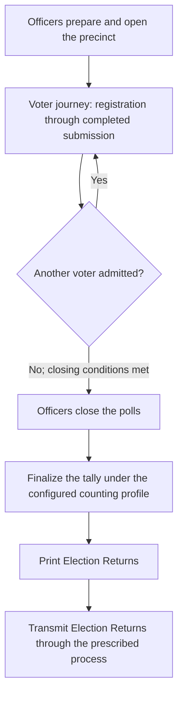
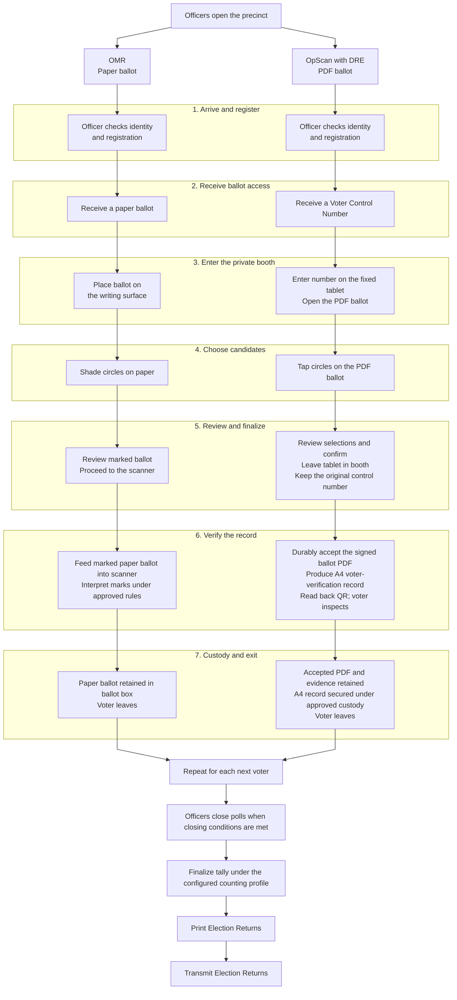
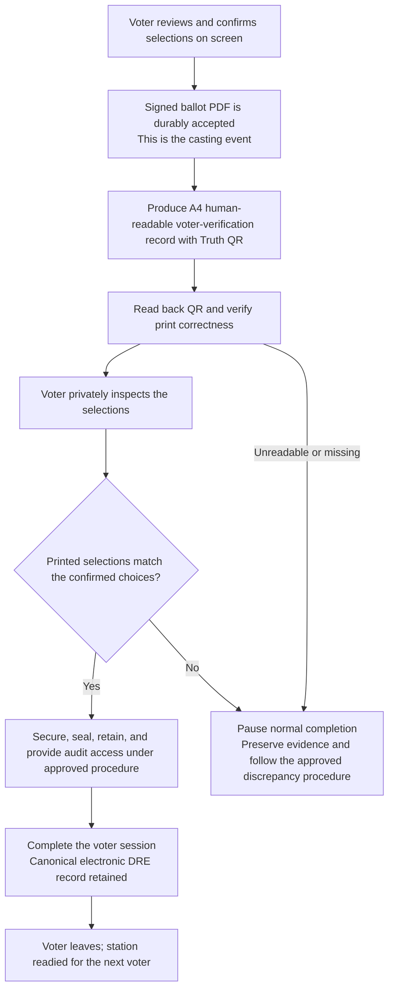

# Voter Journey: OMR and OpScan with DRE

This document describes two distinct ballot profiles. OMR uses a marked paper
ballot as its input to scanning and interpretation. In the proposed OpScan with
DRE profile, the finalized ballot PDF is the **canonical electronic DRE voting
record and tally input**. This system term does not claim that the PDF replaces
the statutory paper “official ballot” or satisfies VVPAT requirements by
itself. See the [legal-position note](LEGAL_POSITION_DRE_CANONICAL_ELECTRONIC_RECORD.md).

## Shared election-day context

## Side-by-side voter journey

## A4 voter-verification and audit path in the DRE bid profile

The offered OpScan with DRE solution includes an A4 human-readable record of
the voter's selections with a Truth QR encoding the corresponding authenticated
selections. The voter is given a private opportunity to inspect it. The QR is
read back to verify print correctness, and the paper is handled, sealed,
retained, and made available for audit under the approved procedure. COMELEC
and the issued procurement documents must designate the artifact's legal role
and approve the final procedure. The prototype's ability to skip printing is
not evidence that the proposed bid profile satisfies VVPAT requirements.

## Voter needs at each stage

| Stage | Question the journey should answer |
|---|---|
| Arrive and register | Am I in the right place? |
| Receive ballot access | What do I take to the booth? |
| Enter the booth | Can I vote privately? |
| Choose candidates | Are these my choices? |
| Review and finalize | Am I ready to submit? |
| Verify the record | Does the record match my choices? |
| Complete and leave | Has my ballot PDF been durably accepted? |
